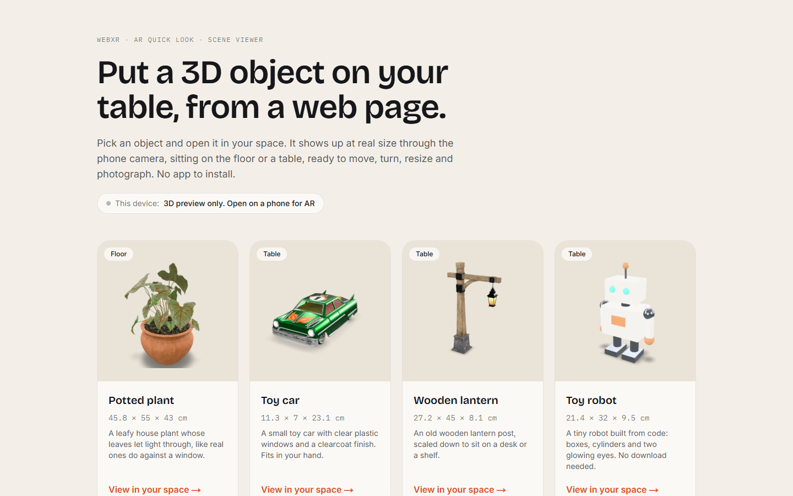
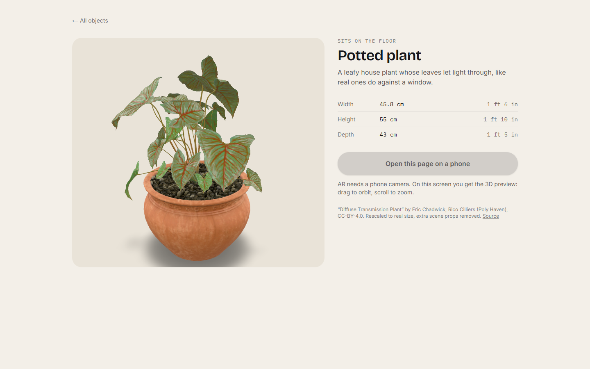
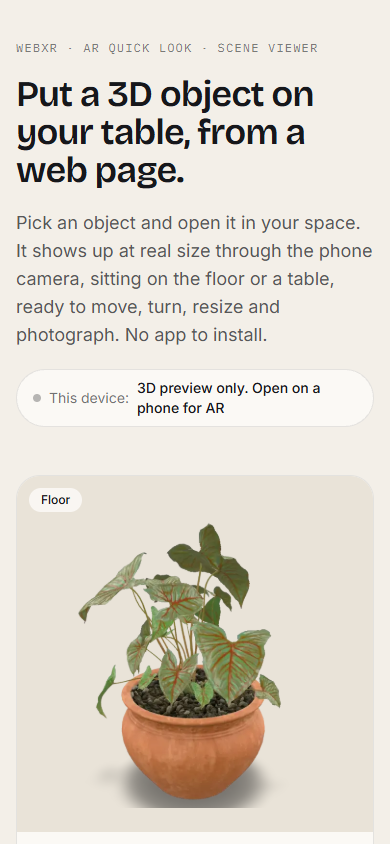
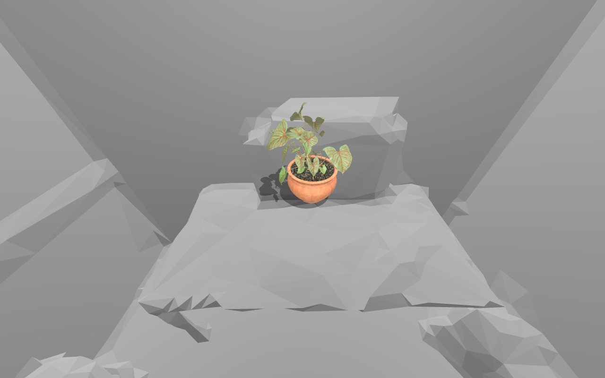
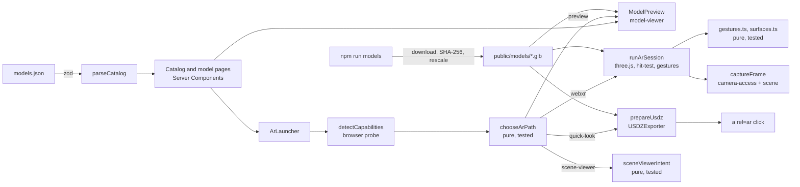

# Web AR Placement

Open a web page on your phone, point the camera at a table or the floor, and a 3D object appears there at its real size. Move it, turn it, resize it, take a photo. No app to install.

> Em português: uma página web que coloca um objeto 3D em tamanho real na sua mesa pela câmera do celular, com WebXR no Android e AR Quick Look no iPhone.



| Desktop preview | Phone layout |
| --- | --- |
|  |  |



_The real WebXR session code running in desktop Chromium on [IWER](https://github.com/meta-quest/immersive-web-emulation-runtime), Meta's WebXR emulator, inside a scanned office: hit-test, placement on the desk and the shadow catcher._

## What it does

- A catalog of four neutral objects (a potted plant, a toy car, a lantern and a toy robot), each with its real width, height and depth in centimetres and inches.
- **View in your space** picks the AR path the device can really run:
  - **Android Chrome:** a WebXR session written with three.js, inside the page. A reticle follows the surface the phone finds; tap to place; one finger drags the object along the surface; two fingers twist to rotate and pinch to resize (25% to 400%). A shadow catcher plane grounds the object, the room's light estimate lights it when the device offers one, and the shutter button saves a photo of camera plus object.
  - **iPhone and iPad:** AR Quick Look. The USDZ it needs is converted from the GLB in the browser, before the tap, so the repository ships one format only.
  - **Desktop:** an orbitable 3D preview with `<model-viewer>`, and a clear note that AR needs a phone.

## Device support

| Device | AR path | Place | Move | Rotate | Scale | Photo |
| --- | --- | --- | --- | --- | --- | --- |
| iPhone / iPad, Safari or any iOS browser | AR Quick Look (USDZ made in the page) | Quick Look | Quick Look | Quick Look | Quick Look | Quick Look shutter |
| Android, Chrome with ARCore | WebXR `immersive-ar` + `hit-test` (this repo) | tap on reticle | one-finger drag | two-finger twist | pinch | in-page shutter |
| Android without WebXR | Google Scene Viewer (intent) | Scene Viewer | Scene Viewer | Scene Viewer | Scene Viewer | system screenshot |
| Desktop | 3D preview | n/a | orbit | orbit | zoom | n/a |

Why not WebXR on the iPhone too? As of October 2026, Safari on iOS still does not expose WebXR `immersive-ar` (Vision Pro gets `immersive-vr` only). Quick Look is the supported way to do AR from a web page on iOS, so the app uses it instead of pretending.

## Architecture



```
src/
  app/                  catalog page and /models/[id]
  catalog/              models.json, zod schema and parser
  components/           ModelPreview, ArLauncher, ArOverlay, DeviceBadge, useArPath
  lib/                  pure modules: capabilities, gestures, surfaces, units, scene-viewer (+ tests)
  xr/                   three.js: AR session, stage (reticle, shadow catcher, lights), capture, USDZ
scripts/                models.ts (fetch + normalise), robot.ts (the generated model)
e2e/                    Playwright: desktop preview, iPhone and Android hand-off, emulated WebXR, screenshots
```

## Run it

Node 22 or newer.

```bash
npm install
npm run models   # downloads the Khronos samples (about 19 MB), checks them, writes public/models
npm run dev      # http://localhost:3000
```

Models are not committed. `npm run models` downloads each sample from a pinned commit of the Khronos repository, checks its SHA-256, keeps only the object (the plant ships with animated fireflies, the car with a cloth), rescales it to the size in the catalog with its base on the ground, and fails if the result does not match the catalog within 1 cm. The toy robot is built from code in `scripts/robot.ts`.

| Command | What it runs |
| --- | --- |
| `npm run lint` | ESLint (Next.js config) |
| `npm run typecheck` | route types, then `tsc --noEmit` in strict mode |
| `npm test` | Vitest: capability matrix, gesture maths, surface filter, units, catalog parsing, Scene Viewer intent |
| `npm run build` | production build |
| `npm run e2e` | Playwright against the build: desktop preview, iPhone USDZ hand-off for all four models, Android fallback, and a full WebXR session (start, hit-test, place, photo) on the IWER emulator |
| `npm run screenshots` | regenerates `public/posters` and `docs/*.png` |

The Playwright commands need `npm run models` and `npm run build` first.

CI (GitHub Actions) runs lint, typecheck, tests and build on every push and pull request.

## Test it on your phone

WebXR, the camera and Scene Viewer only work on HTTPS, so `http://192.168.x.x:3000` is not enough. Two ways:

**A. A quick tunnel (recommended).** It gives you a public HTTPS address with a real certificate, so nothing needs to be trusted by hand.

```bash
npm run build && npm start                       # http://localhost:3000
npx cloudflared tunnel --url http://localhost:3000
```

Open the `https://<random>.trycloudflare.com` address it prints on the phone. The tunnel stays up only while the command runs; stop it with Ctrl+C. Anyone with the address can open the page meanwhile.

**B. Same Wi-Fi, self-signed certificate.**

```bash
npm run dev:phone    # next dev --experimental-https -H 0.0.0.0
```

The first run uses mkcert and asks your computer to trust a local certificate authority. Then open `https://<your computer's LAN IP>:3000` on the phone and accept the certificate warning. Safari lets you continue past it; Chrome on Android may refuse WebXR on a page with a certificate error, so prefer option A there.

On the iPhone: open a model, wait for **View in your space** (it reads "Preparing AR…" while the USDZ is built), tap it, and Quick Look takes over.

## Design decisions

- **Feature detection over user-agent guessing, with one exception.** WebXR support is asked from `navigator.xr`, Quick Look from `relList.supports("ar")`. The user agent only decides the platform, because iPadOS reports itself as a Mac and every iOS browser is WebKit. The decision is a pure function with a test per row of the matrix.
- **USDZ at runtime, prepared before the tap.** Safari only opens Quick Look from a click inside the user's gesture, and converting a 9 MB model takes a moment. The page converts while you read the specs, then the button click is synchronous. One format in the repo, one source of truth for scale.
- **Own WebXR session instead of model-viewer's.** model-viewer is great for the preview, but the placement experience is the point of the project: hit-test reticle, drag on the plane, twist and pinch, shadow catcher, light estimation and a shutter that composites the camera image (WebXR `camera-access`) with the scene.
- **Only floors and table tops count.** Hit-test results whose normal is more than 25 degrees from straight up are skipped, so an object is never stood against a wall. The emulator test caught this one: looking straight ahead, the first hit was the front of a shelf.
- **Dragging uses the plane, not new hit tests.** After placement, a finger is turned into a ray and intersected with the horizontal plane the object sits on. It is steady, cheap and never jumps to a wall.
- **Real size is enforced, not hoped for.** Dimensions live once, in the catalog. The model script rescales each sample to them and refuses to write a model that disagrees.
- **Photos without camera access.** If the browser does not grant `camera-access`, the photo is the object on a transparent background and the overlay says so, instead of silently saving a black frame.

## Credits

| Model | Authors | Licence | Changes |
| --- | --- | --- | --- |
| [Diffuse Transmission Plant](https://github.com/KhronosGroup/glTF-Sample-Assets/tree/main/Models/DiffuseTransmissionPlant) | Eric Chadwick, Rico Cilliers (Poly Haven) | CC BY 4.0 | fireflies, lights and animation removed; rescaled |
| [Toy Car](https://github.com/KhronosGroup/glTF-Sample-Assets/tree/main/Models/ToyCar) | Guido Odendahl, Eric Chadwick | CC0 | cloth and cameras removed; rescaled |
| [Lantern](https://github.com/KhronosGroup/glTF-Sample-Assets/tree/main/Models/Lantern) | sbtron, Frank Galligan | CC0 | rescaled |
| Toy Robot | Leonardo Carnevalli | MIT | generated by `scripts/robot.ts` |

## Licence

MIT © 2026 Leonardo Carnevalli. The Khronos models keep their own licences, listed above.
